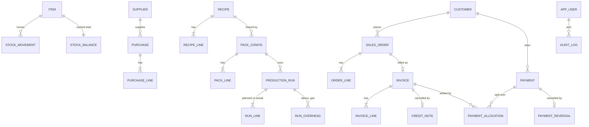

# Design Note — Order-to-Audit

## 1. Problem and approach
A food manufacturer needs one trustworthy trail from buying raw material to being paid, where numbers cannot be
quietly changed. The design choice that drives everything: **record events, never overwrite them**. Stock,
audit entries and credit notes are append-only ledgers; current values (stock on hand, outstanding, cost) are
derived from them.

## 2. Architecture

Controllers never hold business rules; services own `@Transactional`; the database also protects itself
(CHECK constraints, unique keys, triggers), so a bug in Java cannot corrupt the ledger.

## 3. Data model (ER)

`stock_movement` is the single source of truth for stock (+in / −out, `unit_cost`, `source_type/source_id`,
`reverses_id`). `stock_balance` is only a speed-up row updated in the same transaction.

## 4. How stock and BOM consumption are computed
- **Base units.** Every quantity is a whole number of grams, millilitres, pieces or packets (40 kg = 40,000 g,
  10.5 L = 10,500 ml). Screens convert kg/L for people; the database never holds a fraction of a unit.
- **Stock = sum of the ledger.** On hand for an item is `SUM(qty_signed)` over its `stock_movement` rows
  (opening, purchase, production issue, production output, sale, adjustment, reversal). `stock_balance` is a cache
  written in the same transaction and checked against the ledger by `StockService.reconcile()`.
- **BOM = recipe + pack config.** A recipe gives the bulk ingredients for one batch and its bulk yield in grams
  (Murukku: 40 kg flour, 10 L oil, 1.2 kg spice mix, yield 40 kg). A pack config gives the pack size and the
  packaging per packet or per carton (200 g; 1 pouch per packet; 1 carton per 20 packets). So a 500 g pack can share
  the same recipe with a second pack config.
- **Planned quantities** for a batch multiplier `m`: expected packets = floor(yield x m / pack size)
  = 40,000 / 200 = 200; recipe line = quantity x m; per-packet line = quantity x expected packets (200 pouches);
  per-carton line = quantity x ceil(expected packets / packets per carton) (10 cartons).
- **Posting a run** (one transaction): enter actual use per item (defaults to planned), good packets and damaged
  pouches. The system writes one `PROD_ISSUE` movement per item (minus) and one `PROD_OUTPUT` movement (plus good
  packets), each pointing at the run. Variance = (actual - planned) / planned; flagged when |variance| > tolerance
  (3%). Benchmark: yield 188 vs 200 = -6% flagged, oil 10.5 vs 10 = +5% flagged, pouches 194 vs 200 = -3% not flagged.

## 5. Costing and valuation
- **Weighted-average cost**, recalculated from the ledger at every receipt; issues are valued at the current average
  (flour: (100 x 42 + 60 x 45) / 160 = Rs 43.125/kg). Rates are paise per base unit with 4 decimals; money totals
  are integer paise.
- **Run cost** = actual materials x average cost + the run's overheads (labour, gas/power entered on the run).
- **Cost per packet** = run cost / good packets = Rs 5,855 / 188 = Rs 31.14; margin vs the Rs 50 list price 37.71%.
  Overheads are charged to the run they were spent on; damaged output raises the cost of the good packets.

## 6. Key decisions and why
| Decision | Reason | Trade-off |
|---|---|---|
| Integer paise for money | Exact arithmetic, no float drift | Convert for display |
| Base units (g, ml, pcs) in the DB | Whole numbers keep stock exact | Screens convert kg/L |
| Append-only ledgers + triggers | Tamper-evident history, easy audit | Corrections are extra rows |
| Derived soft reservation | One truth; can't go out of sync | Slightly more complex query |
| Weighted-average cost | Simple, standard for blended purchases | Not batch-exact (FEFO is stretch) |
| Shared recipe + separate pack configs | One recipe, many pack sizes | Two concepts to learn |
| Audit row with `Propagation.MANDATORY` | No audit without a business transaction; rollback removes both | Callers must be transactional |
| Gapless invoice numbers from a sequence row | Tax rule; locked row prevents gaps | Serialises invoice creation (fine at this scale) |
| Credit note instead of deleting an invoice | Invoices are legal records | Only full cancellation of unpaid invoices |
| Payment reversal row instead of deleting a payment | A bounced cheque stays in history | Outstanding queries skip reversed payments |

## 7. Concurrency and transactions
- Each use case (post run, dispatch, record payment) is one transaction: all rows commit or none do.
- Stock balance rows are locked (`SELECT … FOR UPDATE`) so two dispatches cannot both take the last packets.
- Invoice and credit-note numbers come from a locked sequence row, giving gapless numbers.
- Order submission carries a request id so a double-tap on a phone cannot create two orders.

## 8. Security
Form login with BCrypt (`{bcrypt}` delegating encoder), CSRF tokens on every POST, sessions managed by Spring
Security, first-match URL rules ending in "anything else needs login". Five roles; the accountant can read stock
but not change it. Password rule: 8–72 chars, a letter and a digit, not equal to the username.

## 9. Testing
508 automated tests on a real PostgreSQL (Testcontainers): unit tests for money/costing/GST maths, integration
tests per service, MockMvc tests for every screen and role rule, and a Playwright browser test that walks the
whole official benchmark. Benchmark figures are asserted as given and never adjusted to make a test pass.
