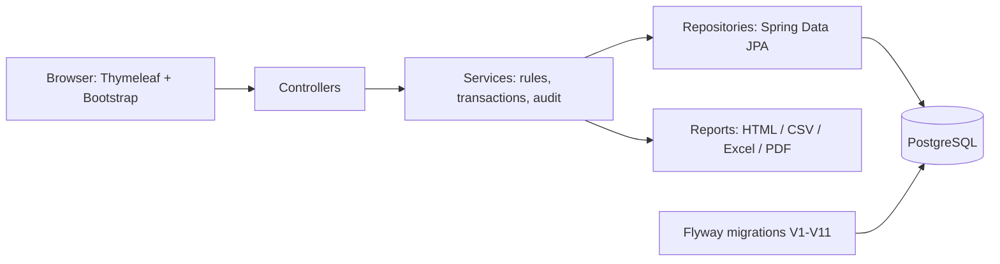
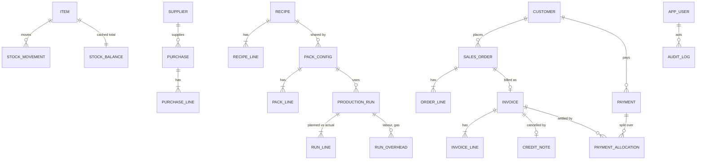

# Design Note — Order-to-Audit

## 1. Problem and approach
A food manufacturer needs one trustworthy trail from buying raw material to being paid, where numbers cannot be
quietly changed. The design choice that drives everything: **record events, never overwrite them**. Stock,
audit entries and credit notes are append-only ledgers; current values (stock on hand, outstanding, cost) are
derived from them.

## 2. Architecture

Controllers never hold business rules; services own `@Transactional`; the database also protects itself
(CHECK constraints, unique keys, triggers), so a bug in Java cannot corrupt the ledger.

## 3. Data model (ER)

`stock_movement` is the single source of truth for stock (+in / −out, `unit_cost`, `source_type/source_id`,
`reverses_id`). `stock_balance` is only a speed-up row updated in the same transaction.

## 4. Key decisions and why
| Decision | Reason | Trade-off |
|---|---|---|
| Integer paise for money | Exact arithmetic, no float drift | Convert for display |
| Base units (g, ml, pcs) in the DB | Whole numbers keep stock exact | Screens convert kg/L |
| Append-only ledgers + triggers | Tamper-evident history, easy audit | Corrections are extra rows |
| Derived soft reservation | One truth; can't go out of sync | Slightly more complex query |
| Weighted-average cost | Simple, standard for blended purchases | Not batch-exact (FEFO is stretch) |
| Shared recipe + separate pack configs | One recipe, many pack sizes | Two concepts to learn |
| Audit row with `Propagation.MANDATORY` | No audit without a business transaction; rollback removes both | Callers must be transactional |
| Gapless invoice numbers from a sequence row | Tax rule; locked row prevents gaps | Serialises invoice creation (fine at this scale) |
| Credit note instead of deleting an invoice | Invoices are legal records | Only full cancellation of unpaid invoices |

## 5. Concurrency and transactions
- Each use case (post run, dispatch, record payment) is one transaction: all rows commit or none do.
- Stock balance rows are locked (`SELECT … FOR UPDATE`) so two dispatches cannot both take the last packets.
- Invoice and credit-note numbers come from a locked sequence row, giving gapless numbers.
- Order submission carries a request id so a double-tap on a phone cannot create two orders.

## 6. Security
Form login with BCrypt (`{bcrypt}` delegating encoder), CSRF tokens on every POST, sessions managed by Spring
Security, first-match URL rules ending in "anything else needs login". Five roles; the accountant can read stock
but not change it. Password rule: 8–72 chars, a letter and a digit, not equal to the username.

## 7. Testing
398 automated tests on a real PostgreSQL (Testcontainers): unit tests for money/costing/GST maths, integration
tests per service, MockMvc tests for every screen and role rule, and a Playwright browser test that walks the
whole official benchmark. Benchmark figures are asserted as given and never adjusted to make a test pass.
